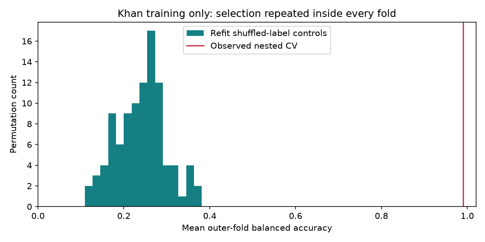
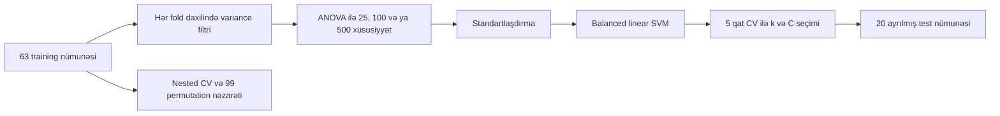

# Fərdi dərs layihəsi: gen ifadəsindən şiş sinfinin təsnifatı



Bu paket repository-dəki 13 layihə arasından sinif təqdimatı üçün seçilmiş ayrıca layihədir. O, real bioloji məlumatı, yüksək ölçülü maşın öyrənməsini, data sızması riskini və elmi nəzarəti bir dərsdə birləşdirir.

## Layihə sualı

Khan mikroarray benchmark-ında yalnız 63 training nümunəsi ilə qurulan model 2308 ifadə xüsusiyyətindən istifadə edərək ayrılmış 20 test nümunəsinin dörd sinfini ayıra bilirmi?

## Niyə bu layihə seçildi?

- Bioloji sual aydındır: şiş nümunələrinin gen ifadəsi profilləri fərqlənirmi?
- Dataset realdır və mənbəsi, sabit revision-u, ölçüləri və SHA-256 dəyərləri sənədləşdirilib.
- Model seçimi yalnız training daxilində aparılır. Ayrılmış test hissəsi yekun qiymətləndirməyə qədər açılmır.
- Dummy model, nested cross-validation və 99 etiket qarışdırması nəticənin təsadüfi olub-olmadığını yoxlayır.
- Nəticə güclüdür, amma məhdudiyyətləri də görünür. Bu, sinif müzakirəsi üçün faydalıdır.

## Paketdə nə var?

| Material | Dərsdə istifadəsi |
|---|---|
| [Dərs planı](LESSON_PLAN.md) | 50 dəqiqəlik təqdimat və 90 dəqiqəlik laboratoriya axını |
| [Tələbə iş vərəqi](STUDENT_WORKSHEET.md) | Metrik, confusion matrix və permutation nəticələrinin şərhi |
| [Layihəyə məxsus təqdimat](presentation/README.md) | Redaktə edilən PowerPoint və danışıq qeydləri |
| [Əsas analiz sənədi](../../intermediate/gene-expression-ml/README.md) | Metod, faktiki nəticə və elmi limitlər |
| [Dataset kartı](../../../datasets/public-datasets/khan.md) | Mənşə, ölçü, hüquq və istifadə sərhədi |
| [Saxlanmış nəticələr](../../../results/expanded-projects/gene-expression-ml/) | Model seçimi, proqnozlar, qrafiklər və run manifesti |
| [Training-only nəzarət](../../../results/research-audit/expression-control/) | Nested CV, permutation testi və probe sabitliyi |

Bu paket kodu və nəticələri kopyalamır. O, mövcud kanonik analizə istinad edir. Beləliklə, dərs materialı ilə faktiki pipeline arasında ikinci, fərqli həqiqət mənbəyi yaranmır.

## Faktiki nəticə

| Göstərici | Nəticə |
|---|---:|
| Training nümunəsi | 63 |
| Ayrılmış test nümunəsi | 20 |
| İlkin xüsusiyyət | 2308 |
| Seçilmiş xüsusiyyət | 25 |
| Seçilmiş `C` | 0.01 |
| Test accuracy | 0.9500, 19/20 düzgün |
| Test balanced accuracy | 0.9583 |
| Test macro F1 | 0.9545 |
| Dummy balanced accuracy | 0.2500 |
| Training-only nested balanced accuracy | 0.9900 |
| 99 permutation üzrə null orta | 0.2419 |
| Permutation p-value | 0.01 |

Bir test nümunəsində (`test_15`) həqiqi sinif 2 (EWS) olduğu halda model sinif 4 (RMS) proqnoz edib. Bu nümunənin dörd qərar dəyərinin hamısı mənfidir (ən yüksəyi RMS: −0.06, EWS: −0.20), yəni model burada qərarsızdır.

## Genişləndirilmiş analiz: adlı siniflər, genlər və sızma təcrübəsi

[`scripts/build_khan_annotation.py`](../../../scripts/build_khan_annotation.py) ISLP fayllarını CRAN `plsgenomics` 1.5-3 paketindəki adlı `SRBCT` məlumatı ilə ədədi olaraq tutuşdurur. Hər nümunə tam bir SRBCT nümunəsinə uyğun gəlir (korrelyasiya ≥ 0.9999), hər sütun eyni indeksli genə uyğun gəlir (minimum 0.992). Uyğunluq tək mənalı deyilsə skript xəta verir.

| ISLP sinfi | Şiş | Training | Test |
|---:|---|---:|---:|
| 1 | Burkitt limfoması (BL) | 8 | 3 |
| 2 | Ewing sarkoması (EWS) | 23 | 6 |
| 3 | Neyroblastoma (NB) | 12 | 6 |
| 4 | Rabdomiosarkoma (RMS) | 20 | 5 |

Nəticə: [`datasets/annotations/`](../../../datasets/annotations/) (2308 prob üçün IMAGE klon ID-si və təsvir). Model training daxilində seçdiyi 25 probun arasında Khan və b. (2001) məqaləsinin məlum markerlərini özü tapır: **FGFR4** (RMS), **CD99/MIC2** antigeni 12E7 (EWS), **FCGRT** və **caveolin 1** (EWS), **IGF2** (RMS).

[`scripts/run_khan_showcase.py`](../../../scripts/run_khan_showcase.py) protokolu dəyişmədən dörd əlavə görünüş yaradır. Saxlanmış nəticə: [`results/showcase/khan-classifier/`](../../../results/showcase/khan-classifier/).

| Görünüş | Nəticə |
|---|---|
| PCA, 2308 prob (yalnız training-ə fit) | PC1+PC2 = 25%; siniflər qarışıqdır |
| PCA, 25 seçilmiş prob | PC1+PC2 = 65%; dörd klaster aydın ayrılır |
| Sızma təcrübəsi, 100 qarışdırılmış etiket | Seçim CV-dən **əvvəl**: orta balanced accuracy **0.53**; seçim CV **daxilində**: **0.24** (təsadüf 0.25) |
| Test qərar dəyərləri | Yeganə səhv ən aşağı marjlı nümunədir |

Sızma təcrübəsi layihənin əsas metodoloji dərsini rəqəmlə göstərir: etiketlər tamamilə təsadüfi olsa belə, xüsusiyyət seçimini bütün training üzərində edib sonra CV aparmaq modelin "öyrəndiyi" illüziyasını yaradır.

```bash
uv run --with rdata python scripts/build_khan_annotation.py
python scripts/run_khan_showcase.py
```

Sinif adları indi təsdiqlənib, amma gen siyahısı biomarker iddiası deyil: seçilən problar fold-dan fold-a dəyişir (orta Jaccard 0.26).

## Analiz məntiqi



Feature selection fold-dan kənarda aparılsa, validation nümunələrinin məlumatı model seçiminə sızar. Bu layihənin əsas metodoloji dərsi həmin sızmanın qarşısını alan `Pipeline` quruluşudur.

## İşlətmə

Repo kökündə:

```bash
python -m venv .venv
.venv\Scripts\Activate.ps1
python -m pip install -e ".[dev]"
biolab run expression-ml
```

Linux və macOS-da aktivləşdirmə əmri `source .venv/bin/activate` şəklindədir. İlk icra dörd sabitlənmiş CSV-ni endirir və hash-ləri yoxlayır. Hər icra `results/runs/gene-expression-ml/` daxilində yeni qovluq yaradır.

Birbaşa skriptlə eyni analiz:

```bash
python scripts/fetch_khan.py
python scripts/run_expression_ml.py
```

## Təqdimatda göstəriləcək sübutlar

1. `summary.json` dataset ölçülərini, seçilən parametrləri və test metriklərini saxlayır.
2. `predictions.csv` 20 test nümunəsinin həqiqi və proqnoz sinfini göstərir.
3. `confusion_matrix.png` yeganə səhvin sinif 2-dən sinif 4-ə keçdiyini göstərir.
4. `permutation_control.png` real nested nəticəni qarışdırılmış etiketlərin paylanması ilə müqayisə edir.
5. `run.json` input hash-lərini, parametrləri, paket versiyalarını və output hash-lərini saxlayır.

## Elmi sərhəd

Bu nəticə tarixi, əvvəlcədən emal edilmiş mikroarray benchmark-ına aiddir. Test hissəsi cəmi 20 nümunədir. `V1..V2308` sütunları təsdiqlənmiş gen simvolları deyil. Nəticə erkən diaqnostika, biomarker kəşfi və ya klinik istifadə sübutu vermir. Növbəti elmi addım annotasiyalı, batch metadata-sı olan müstəqil cohort üzrə əvvəlcədən müəyyən edilmiş qiymətləndirmədir.

## Təhvil veriləcək fərdi layihə

Tələbə təqdimatdan sonra aşağıdakı dörd hissəni təhvil verir:

- işlədilmiş run qovluğunun yolu və `run.json` faylı
- confusion matrix üzrə bir abzaslıq səhv təhlili
- permutation testinin mənasını izah edən qısa cavab
- klinik iddia yaratmadan növbəti eksperiment təklifi

