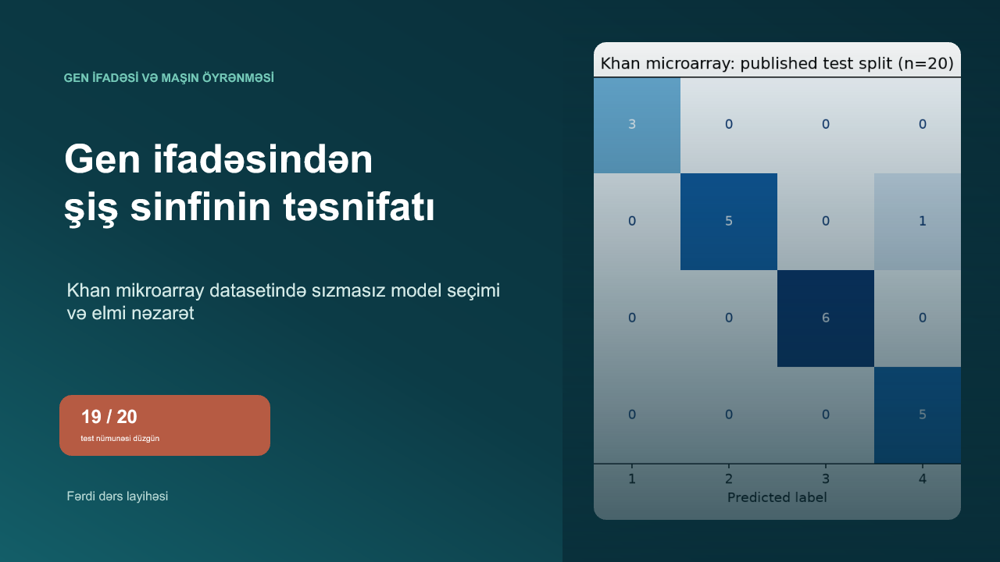

# Layihəyə məxsus təqdimat

[PowerPoint təqdimatını açın](khan-gene-expression-classifier-az.pptx).

Təqdimat 16:9 formatındadır və yalnız Khan gen ifadəsi layihəsini izah edir. Slaydlarda real saxlanmış nəticələr, redaktə edilən mətn və sxemlər, iki native qrafik, dərs sualları və 16 danışıq qeydi var. Hər slaydda yüngül keçid animasiyası saxlanılıb. Təxminən 20 dəqiqəlik təqdimat və qısa sinif müzakirəsi üçün hazırlanıb.

Elmi şəkillər bu repository-də saxlanmış analiz nəticələrindən götürülüb. Əsas mənbə və məhdudiyyətlər slaydların danışıq qeydlərində göstərilir.
